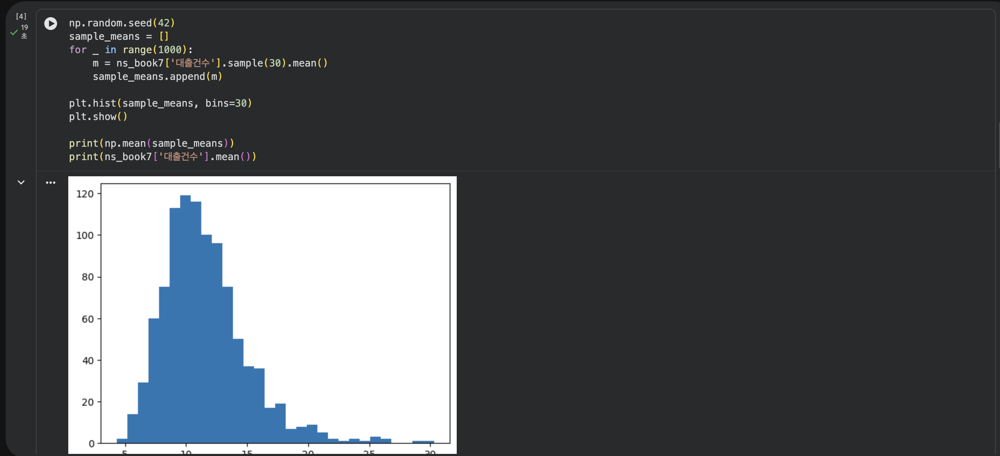
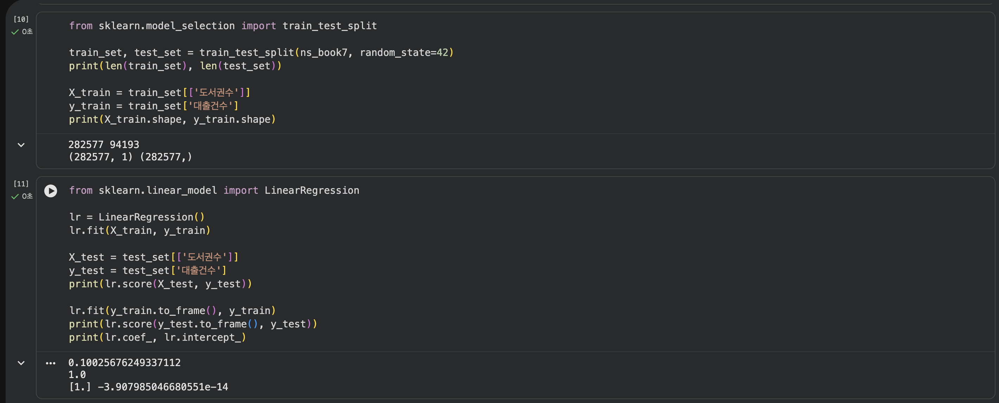
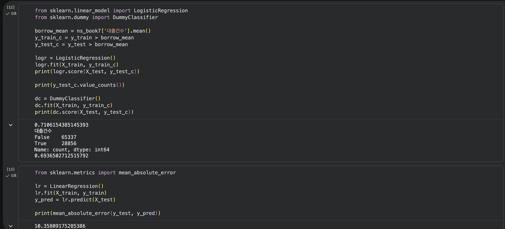

# 데이터분석 7주차 정규과제

📌데이터분석 정규과제는 매주 정해진 분량의 『*혼자 공부하는 데이터 분석 with 파이썬*』 을 읽고 학습하는 것입니다. 이번 주는 아래의 **DataAnalysis_7th_TIL**에 나열된 분량을 읽고 공부하시면 됩니다.

아래의 문제를 풀어보며 학습 내용을 점검하세요. 문제를 해결하는 과정에서 개념을 스스로 정리하고, 필요한 경우 제시된 강의를 참고하여 보완하는 것이 좋습니다.

<!-- 강의 링크는 아래와 같습니다.
https://www.youtube.com/watch?v=R3E4m8fqUSg&list=PLVsNizTWUw7FGzSRCkQrPEEe-ljVXgS7k&index=14
https://www.youtube.com/watch?v=W_cxRstQUk8&list=PLVsNizTWUw7FGzSRCkQrPEEe-ljVXgS7k&index=15
-->


## DataAnalysis_7th_TIL

### 7장 검증하고 예측하기
#### 01. 통계적으로 추론하기
#### 02. 머신러닝으로 예측하기


## Study Schedule

| 주차  | 공부 범위     | 완료 여부 |
| ----- | ------------- | --------- |
| 1주차 | p.24~81    | ✅         |
| 2주차 | p.84~151   | ✅         |
| 3주차 | p.154~219  | ✅         |
| 4주차 | p.222~279 | ✅         |
| 5주차 | p.282~325 | ✅         |
| 6주차 | p.328~379 | ✅         |
| 7주차 | p.382~430 | ✅         |

<br>

<!-- 여기까진 그대로 둬 주세요-->


# 1️⃣ 개념 정리 

## 01. 통계적으로 추론하기

### 표준점수 (z점수)

- 평균에서 표준편차의 몇 배만큼 떨어져 있는지 나타낸 값
- z = (x − 평균) / 표준편차
- `stats.zscore()` : z점수 계산

### 표준정규분포

- 평균이 0, 표준편차가 1인 정규분포
- z점수 ±1 사이 → 약 68%, ±2 사이 → 약 95%
- `norm.cdf()` : z점수 → 누적 분포 비율
- `norm.ppf()` : 누적 분포 비율 → z점수 (cdf의 반대)

### 중심극한정리

- 표본을 여러 번 뽑아 구한 표본 평균들은 정규분포에 가까워짐
- 표본 평균의 평균 ≈ 모집단의 평균
- 표본 크기는 보통 30 이상이 좋음

### 표준오차

- 표본 평균의 표준편차
- 표준오차 = 표본의 표준편차 / √표본 크기

### 신뢰구간

- 표본으로 추정한 모집단 평균이 들어 있을 것으로 보는 범위
- 95% 신뢰구간 → 평균 ± 1.96 × 표준오차
- 1.96 = `norm.ppf(0.975)`

### 가설검정

- 표본으로 두 모집단 평균에 차이가 있는지 확인하는 것
- 귀무가설 : 차이가 없다 / 대립가설 : 차이가 있다
- p-값이 작으면(보통 0.05 미만) 귀무가설 기각

#### t-검정

- `stats.ttest_ind()` : 두 표본의 평균 비교 → t값, p-값 반환
- 모수 검정 : 모집단이 정규분포를 따른다고 가정

#### 순열검정

- 두 표본을 섞어 무작위로 다시 나눈 뒤 평균 차이를 반복 계산해 p-값 구하기
- 비모수 검정 : 모집단 분포를 가정하지 않음
- `stats.permutation_test()`


## 02. 머신러닝으로 예측하기

### 훈련 세트와 테스트 세트

- 모델 학습용(훈련)과 성능 평가용(테스트)으로 데이터 나누기
- `train_test_split()` : 기본 75% 훈련 / 25% 테스트
- `test_size` 매개변수 : 테스트 세트 비율 지정

### 선형 회귀

- 입력과 타깃 사이의 관계를 직선으로 학습해 숫자 값 예측
- `LinearRegression()` → `fit()`으로 학습
- `score()` : 결정계수(R²), 1에 가까울수록 좋음
- `coef_` : 기울기 / `intercept_` : 절편

### 로지스틱 회귀

- 이름은 회귀지만 분류 모델 (예: 대출건수가 평균보다 높은지/낮은지)
- `LogisticRegression()`
- `score()` : 정확도

### 더미 모델

- `DummyClassifier()` : 가장 많은 클래스로만 예측하는 기준 모델
- 내 모델이 더미 모델보다 나은지 비교하는 용도

### 회귀 모델 평가

- `predict()` : 테스트 데이터로 예측
- `mean_absolute_error()` : 평균 절댓값 오차(MAE)
- `mean_squared_error()` : 평균 제곱 오차(MSE)


# 2️⃣ 수행 인증








<br>
<br>

# 3️⃣ 확인 문제

## 문제 1.

> **🧚Q. 어떤 표본의 크기가 충분히 크고(n ≥ 30), 모집단 분산을 알 수 없을 때 모평균에 대한 신뢰구간을 구하려고 한다.
이때 다음 설명 중 가장 적절한 것은 무엇인가?**

```
1️⃣ 표본의 크기가 충분히 크므로 중심극한정리에 의해 표본평균의 분포는 근사적으로 정규분포를 따른다.  
2️⃣ 모집단 분산을 모르므로 신뢰구간을 구할 수 없다.  
3️⃣ 표본이 30개 이상이면 항상 모집단도 정규분포를 따른다.  
4️⃣ 중심극한정리는 모집단이 정규분포일 때만 적용된다.
```

```
정답: 1️⃣
표본이 충분히 크면 모집단 분포와 상관없이 중심극한정리에 의해 표본평균의 분포가 근사적으로 정규분포를 따르고, 모집단 분산을 몰라도 표본 표준편차로 표준오차를 추정해 신뢰구간을 구할 수 있다.
```

## 문제 2.

> **🧚Q. 다음 중 순열검정(permutation test)에 대한 설명으로 가장 옳은 것은 무엇인가?**

```
1️⃣ 모집단이 정규분포를 따른다는 가정을 반드시 해야 한다.  
2️⃣ 표준점수(z-score)를 이용하여 유의확률을 계산하는 방법이다.  
3️⃣ 데이터의 라벨을 무작위로 섞어 귀무가설 하에서의 분포를 직접 구성하는 비모수적 검정 방법이다.  
4️⃣ 표본의 크기가 충분히 클 때만 사용할 수 있다.
```

```
정답: 3️⃣
순열검정은 두 표본을 합쳐 무작위로 섞은 뒤 다시 나누는 과정을 반복해 귀무가설 하의 분포를 직접 만들고 p-값을 구하는 방법으로, 모집단 분포를 가정하지 않는 비모수 검정이다.
```


### 🎉 수고하셨습니다.