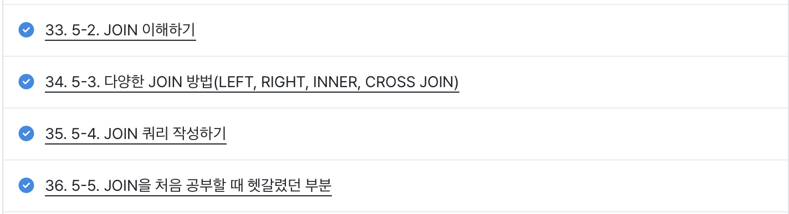
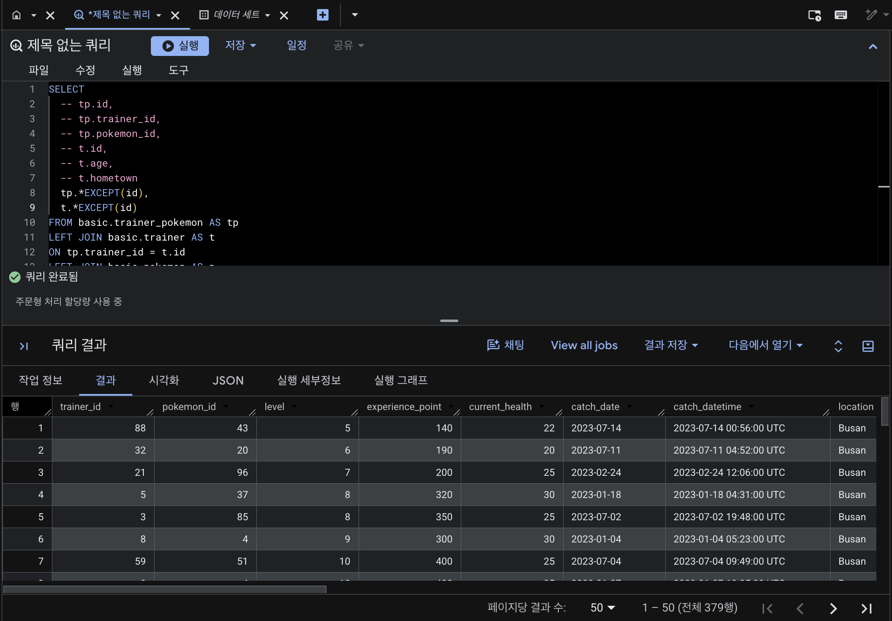
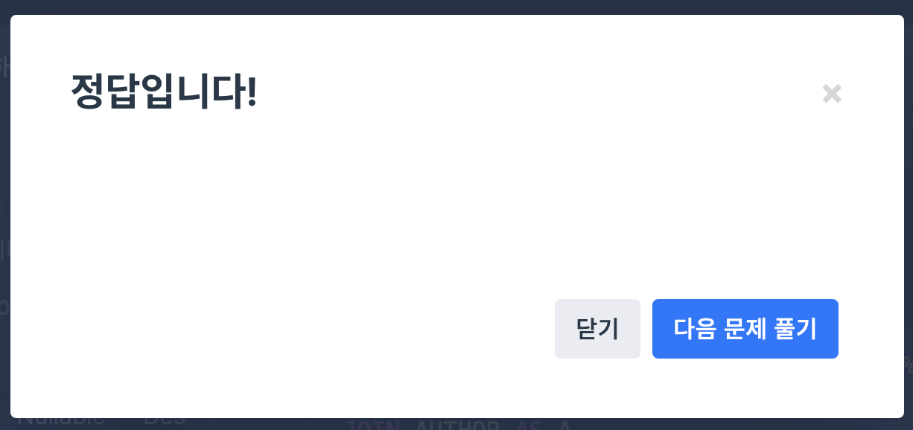
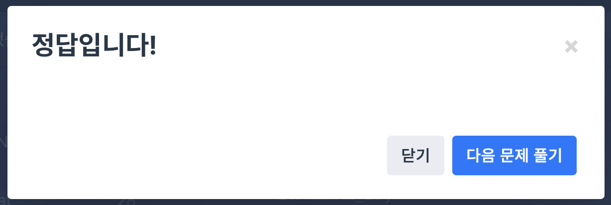

# 📘 SQL_BASIC 6주차 정규 과제

SQL_BASIC 정규 과제는 매주 정해진 분량의 `초보자를 위한 BigQuery(SQL) 입문` 강의를 듣고, 핵심 개념을 정리한 뒤 간단한 SQL 문제를 직접 풀어보는 방식으로 진행합니다.

이번 주는 SQL 입문 과정의 핵심 고비인 `JOIN`을 학습합니다.

JOIN은 여러 테이블을 연결해서 분석 질문에 답하기 위해 반드시 필요한 개념입니다. 이번 주 과제에서는 정답 코드뿐 아니라 **어떤 테이블을 어떤 키로 연결했는지**를 꼭 기록해주세요.

완성된 과제는 Github에 업로드하고, 링크를 스프레드시트 'SQL' 시트에 입력해 제출해주세요.

**👀 수행 인증란은 필수입니다.**

---

## 📚 SQL_BASIC_6th_TIL

### 섹션 6. 다량의 자료를 연결 : JOIN

### 5-2. JOIN 이해하기

### 5-3. 다양한 JOIN 방법

### 5-4. JOIN 쿼리 작성하기

### 5-5. JOIN을 처음 공부할 때 헷갈리는 부분

---

## ✨ 선택 강의

- 5-6. JOIN 연습문제: JOIN 문제를 더 연습하고 싶을 때 선택 수강

---

## 🏁 전체 강의 수강 계획

| 주차 | 필수 강의 범위 | 선택 강의 | 완료 여부 |
| --- | --- | --- | --- |
| 1주차 | 1-1 ~ 2-1 | 1 | ✅ |
| 2주차 | 2-2 ~ 2-3 | 2-4 | ✅ |
| 3주차 | 2-5, 2-7 ~ 2-8 | 2-6 | ✅ |
| 4주차 | 3-2 ~ 4-3 | 3-4 | ✅ |
| 5주차 | 4-4 ~ 4-6 | 4-5, 4-7 | ✅ |
| 6주차 | 5-2 ~ 5-5 | 5-6 | ✅ |
| 7주차 | 필수 강의 없음 | 6-2, 6-3, 6-4, 6-5 | 🍽️ |

---

<br>

<!-- 여기까진 그대로 둬 주세요-->

---

# 1️⃣ 개념 정리

## JOIN

- 서로 다른 테이블을 연결하는 것

> 💡 공통적으로 존재하는 컬럼(= Key)이 있다면 JOIN 가능

### 필요성

- 정규화 : 중복을 최소화하도록 데이터를 구조화
- 다양한 테이블에 나눠 저장하고, 필요할 때 JOIN으로 연결

## JOIN 방법

- INNER JOIN : 두 테이블의 공통 요소만 연결
- LEFT / RIGHT JOIN : 왼쪽 / 오른쪽 테이블 기준으로 연결
- FULL JOIN : 양쪽 기준으로 연결
- CROSS JOIN : 두 테이블의 모든 요소를 곱해서 연결 (모든 조합)

## JOIN 쿼리 작성

### 흐름

1. 테이블 확인 : 테이블에 저장된 데이터, 컬럼 확인
2. 기준 테이블 정의 : 가장 많이 참고할 기준(base) 테이블 정의
3. JOIN Key 찾기 : 여러 테이블과 연결할 Key 정리
4. 결과 예상하기 : 결과 테이블을 손이나 엑셀로 미리 작성 (정답지 역할)
5. 쿼리 작성 / 검증 : 예상한 결과와 동일한 결과가 나오는지 확인

### 문법

```sql
SELECT
  A.col1,
  A.col2,
  B.col1,
  B.col2
FROM table1 AS A
LEFT JOIN table2 AS B
ON A.key = B.key
```

## 주의점

1. 여러 JOIN 중 어떤 것을 사용해야 할까?
   - 작업의 목적에 따라 선택
2. 어떤 테이블을 왼쪽에 둘까?
   - 기준 테이블을 왼쪽에 두기
   - 오른쪽에는 계속 데이터를 추가
3. 여러 테이블을 연결할 수 있을까?
   - 한계는 없으나 너무 많이 연결하지 않는 것이 좋음
4. 컬럼은 모두 다 선택해야 할까?
   - 무엇을 하고자 하느냐에 따라 다름
   - 사용하지 않을 컬럼은 선택하지 않는 것이 비용을 줄이는 방법
5. NULL이란?
   - 값이 없음, 알 수 없음
   - 0, 공백과는 다름

---

# 2️⃣ 수행 인증란

아래 중 하나 이상을 첨부해주세요.




---

# 3️⃣ 확인 문제

프로그래머스는 로그인이 필요하므로, 로그인 후 문제 풀이를 진행해주세요.

## 🧩 문제 1

문제 링크: [조건에 맞는 도서와 저자 리스트 출력하기](https://school.programmers.co.kr/learn/courses/30/lessons/144854)

풀이 과정:

```
- 사용한 테이블: BOOK, AUTHOR
- JOIN key: AUTHOR_ID (BOOK.AUTHOR_ID = AUTHOR.AUTHOR_ID)
- 날짜를 출력한 형식: YYYY-MM-DD (DATE_FORMAT(PUBLISHED_DATE, '%Y-%m-%d'))
```



## 🧩 문제 2

문제 링크: [상품 별 오프라인 매출 구하기](https://school.programmers.co.kr/learn/courses/30/lessons/131533)

풀이 과정:

```
- 연결한 테이블: PRODUCT, OFFLINE_SALE
- JOIN key: PRODUCT_ID (PRODUCT.PRODUCT_ID = OFFLINE_SALE.PRODUCT_ID)
- 집계한 값: 상품코드별 매출액 합계 SUM(PRICE * SALES_AMOUNT)
```


## 🧩 문제 3

문제 링크: [없어진 기록 찾기](https://school.programmers.co.kr/learn/courses/30/lessons/59042)

풀이 과정:

```
- 기준이 되는 왼쪽 테이블: ANIMAL_OUTS
- LEFT JOIN이 필요한 이유: 입양 기록(ANIMAL_OUTS)은 전부 남기면서 보호소에 들어온 기록(ANIMAL_INS)이 있는지 확인해야 하기 때문. INNER JOIN을 쓰면 양쪽에 모두 있는 동물만 남아서, 정작 찾아야 하는 유실된 동물이 결과에서 사라짐
- NULL이 발생하는 경우: ANIMAL_OUTS에는 있지만 ANIMAL_INS에는 해당 ANIMAL_ID가 없을 때, ANIMAL_INS 쪽 컬럼이 NULL이 됨 → 이 행이 데이터가 유실된 동물
```


## 🧩 문제 4

문제 링크: [있었는데요 없었습니다](https://school.programmers.co.kr/learn/courses/30/lessons/59043)

풀이 과정:

```
- 사용한 테이블: ANIMAL_INS, ANIMAL_OUTS
- JOIN key: ANIMAL_ID (ANIMAL_INS.ANIMAL_ID = ANIMAL_OUTS.ANIMAL_ID)
- 비교한 날짜 컬럼: ANIMAL_INS.DATETIME(보호 시작일)과 ANIMAL_OUTS.DATETIME(입양일), 입양일이 보호 시작일보다 빠른 경우(ANIMAL_OUTS.DATETIME < ANIMAL_INS.DATETIME)
- 정렬 기준: 보호 시작일(ANIMAL_INS.DATETIME) 오름차순
```



---

# 4️⃣ 참고 자료

JOIN 개념이 헷갈린다면 아래 자료를 함께 참고해도 좋습니다.

1. https://data-marketing-bk.tistory.com/entry/SQL-JOIN-%ED%95%9C-%EB%B0%A9%EC%97%90-%EC%A0%95%EB%A6%AC-%EA%B0%9C%EB%85%90%EB%B6%80%ED%84%B0-%EC%BD%94%EB%93%9C%EA%B9%8C%EC%A7%80-%EC%9D%B4%EA%B2%83%EB%A7%8C-%EB%B3%B4%EC%9E%90
2. https://velog.io/@wijoonwu/JOIN

---

# 5️⃣ 이번 주 회고

```
1. INNER JOIN과 LEFT JOIN의 차이를 어떻게 이해했는지:
2. JOIN 문제를 풀 때 가장 먼저 확인해야 할 것:
3. JOIN 결과가 예상과 달랐던 경험이 있다면:
```

수고하셨습니다!


